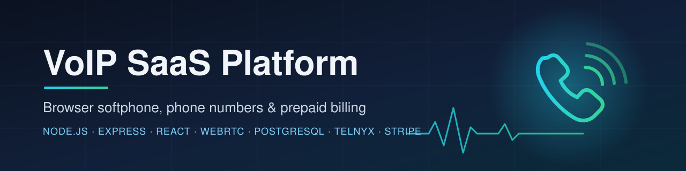
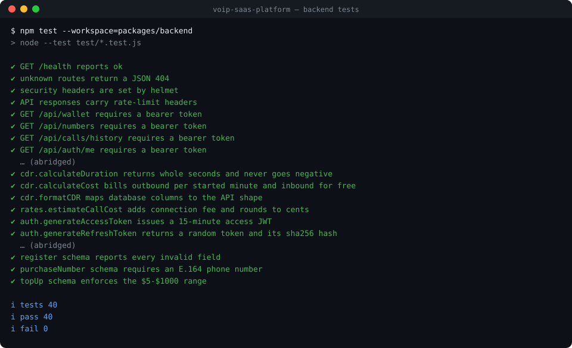
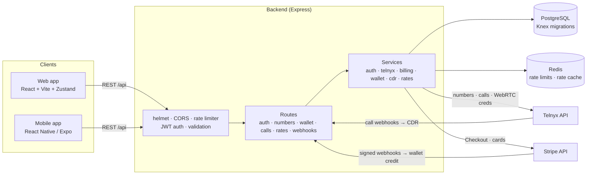

<p align="center">
  
</p>

<p align="center"><b>Browser softphone, phone numbers &amp; prepaid billing: a full-stack VoIP SaaS reference implementation.</b></p>

<p align="center">
  <a href="LICENSE"></a>
  
  <a href="https://github.com/muhib-karim/voip-saas-platform/actions/workflows/ci.yml"></a>
</p>

---

## What it is

A **reference implementation** of a Skype-style VoIP SaaS: users sign up, buy virtual phone numbers (DIDs), top up a prepaid wallet with Stripe, and place calls from a web softphone. Telephony goes through the [Telnyx](https://telnyx.com) API.

It's an npm-workspaces monorepo with three apps:

| Package | Stack | What's in it |
|---|---|---|
| `packages/backend` | Node.js, Express, Knex, PostgreSQL, Redis | REST API, 6 route modules (30 endpoints plus `/health`), Telnyx and Stripe integrations, 2 Knex migrations (11 tables) |
| `packages/frontend` | React 18, Vite, TypeScript, Zustand | Dashboard, Numbers, Wallet, Calls, Settings, Login/Register, dialpad softphone |
| `packages/mobile` | React Native, Expo | 6 screens (login, register, dashboard, dialer, calls, settings) |

> **Status: reference implementation, not a hosted product.** There is no public demo. Running it end-to-end needs your own Telnyx and Stripe accounts plus PostgreSQL and Redis. The automated tests here cover the backend's HTTP layer and business logic offline, without those services. See [Limitations](#limitations).

## Key features (as implemented)

- **Auth:** registration and login with bcrypt-hashed passwords. You get a 15-minute JWT access token and a 7-day refresh token in an HTTP-only cookie. Refresh tokens are rotated and stored hashed (SHA-256), and sessions can be listed and revoked.
- **Phone numbers:** search available Telnyx numbers by country, area code and type (local / toll-free / mobile), then buy them (charged to the wallet) or release them.
- **Wallet and payments:** prepaid balance, Stripe Checkout top-ups (minimum $5), transaction history, saved cards. Stripe webhooks are checked against their signature.
- **Calling:** outbound calls go through Telnyx Call Control after the backend checks that the user owns the caller ID. It can also issue Telnyx WebRTC credentials (`GET /api/calls/token`).
- **Call detail records:** Telnyx call webhooks update a `cdr` table (initiated, ringing, answered, hangup). Each record gets a duration and a cost, and there are history and stats endpoints.
- **Rates:** a per-country rate table with Redis caching and a call-cost estimator.
- **Hardening:** helmet headers, CORS limited to the frontend origin, a 10 kB JSON body limit, a Redis-backed rate limiter (with a stricter limit on login and register), and request validation middleware.

## Demo

There's no hosted demo. This is real output from the backend test suite (abridged and re-rendered as SVG; per-test timings removed):

<p align="center"></p>

## Quick start

**Prerequisites:** Node.js 18+ (CI uses 22), PostgreSQL 15 and Redis 7. You can run both with `docker-compose up -d postgres redis`. For calls and payments you also need Telnyx and Stripe credentials.

```bash
git clone https://github.com/muhib-karim/voip-saas-platform.git
cd voip-saas-platform

# Install the backend + web frontend (the Expo app is installed separately)
npm install -w packages/backend -w packages/frontend

cp .env.example .env          # then fill in Telnyx / Stripe keys and a strong JWT_SECRET
npm run db:migrate            # creates the schema in PostgreSQL
npm run dev                   # backend on :5000, Vite dev server on :3000 (proxies /api)
```

Mobile app (optional): `npm install -w packages/mobile && npm run dev:mobile`.

## Usage

```bash
# Health check
curl http://localhost:5000/health

# Register, then use the returned accessToken
curl -X POST http://localhost:5000/api/auth/register \
  -H 'Content-Type: application/json' \
  -d '{"email":"you@example.com","password":"a-long-password","firstName":"Ada","lastName":"Lovelace"}'

# Estimate a 3-minute call to the UK
curl -X POST http://localhost:5000/api/rates/estimate \
  -H 'Content-Type: application/json' -d '{"countryCode":"GB","duration":3}'
```

### API overview

| Area | Endpoints |
|---|---|
| Auth `/api/auth` | `POST /register`, `POST /login`, `POST /refresh`, `POST /logout`, `POST /logout-all`, `GET /me`, `PATCH /profile`, `POST /change-password`, `GET /sessions`, `DELETE /sessions/:id` |
| Numbers `/api/numbers` | `GET /`, `GET /search`, `POST /purchase`, `DELETE /:id` |
| Wallet `/api/wallet` | `GET /`, `POST /topup`, `GET /transactions`, `GET /payment-methods`, `POST /setup-payment` |
| Calls `/api/calls` | `GET /token`, `POST /`, `GET /history`, `GET /stats`, `GET /:id` |
| Rates `/api/rates` | `GET /`, `GET /:countryCode`, `POST /estimate` |
| Webhooks `/api/webhooks` | `POST /stripe`, `POST /telnyx`, `POST /telnyx/call` |

## Architecture



`src/app.js` builds the Express app and `src/index.js` connects Redis and starts the server. Keeping them apart lets the tests load the app without opening a port.

## Testing

```bash
npm install -w packages/backend -w packages/frontend

npm test --workspace=packages/backend            # 40 tests (node:test + supertest), no DB/Redis needed
npm run lint --workspace=packages/backend        # ESLint
npm run type-check --workspace=packages/frontend # tsc --noEmit
npm run build --workspace=packages/frontend      # production Vite build
```

The backend suite covers both validation middlewares, the JWT auth guard (missing, forged and expired tokens), the rate limiter, CDR duration and cost maths, the call-cost estimator, token generation, Stripe webhook signature rejection, and the 404 and health routes. [CI](.github/workflows/ci.yml) runs exactly these commands on every push and pull request.

`tests/e2e/` holds Playwright specs (`npm run test:e2e`). They need the full stack running and aren't part of CI.

## Project structure

```
.
├── packages/
│   ├── backend/
│   │   ├── src/
│   │   │   ├── app.js           # Express app (middleware + routes)
│   │   │   ├── index.js         # server bootstrap, Redis init, graceful shutdown
│   │   │   ├── config/          # env config, Knex, Redis cache wrapper
│   │   │   ├── middleware/      # auth, validation, rate limiting, error handler
│   │   │   ├── routes/          # auth, numbers, wallet, calls, rates, webhooks
│   │   │   └── services/        # auth, telnyx, billing (Stripe), wallet, cdr, rates
│   │   ├── migrations/          # Knex schema migrations
│   │   └── test/                # node:test unit + HTTP tests
│   ├── frontend/src/            # React app: pages/, components/, store/, services/
│   └── mobile/src/              # Expo app: screens/, store/, services/
├── tests/e2e/                   # Playwright specs
├── deploy/                      # Kubernetes manifest + deploy script (templates)
├── docker-compose.yml           # Postgres, Redis, backend, frontend for local dev
└── .github/workflows/           # ci.yml (lint/test/build), ci-cd.yml (Docker images)
```

## Limitations

- **The browser doesn't carry call audio.** The web softphone places calls through the backend (Telnyx Call Control) and keeps call state in the browser. `@telnyx/webrtc` is a dependency and the backend issues WebRTC tokens, but no in-browser media session is wired up. Mute, hold and DTMF only change local UI state, and there's no hangup endpoint on the backend yet.
- **Rate limiting fails open without Redis.** If Redis is down, every request is allowed (covered by a test).
- **Stripe and Telnyx paths aren't integration-tested.** They need real credentials.
- **Leftover files in the frontend.** `packages/frontend/src` still has older `.jsx` versions of some components next to the `.tsx` ones. Only the `.tsx` tree (entry `main.tsx`) is built.
- **The mobile app isn't built or tested in CI.**
- **`ci-cd.yml` only triggers on `main`/`develop`.** The default branch is `master`, so the Docker image workflow is effectively dormant.

## Tech stack

- **Language:** JavaScript
- **Frameworks and tools:** Playwright, Express, PostgreSQL, Stripe, React, Vite, TypeScript, Vitest, React Native, Docker
- **CI:** GitHub Actions

## Contributing

Issues and pull requests are welcome. See [CONTRIBUTING.md](CONTRIBUTING.md) for the workflow. Before opening a pull request, run `npm test` and `npm run lint`. Please keep each pull request focused and say how you tested it.

## License

[MIT](LICENSE) © 2026 Muhib Al Karim
